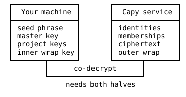
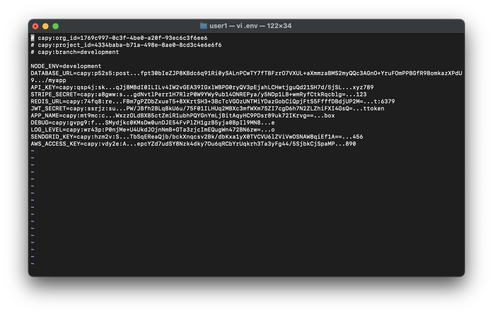
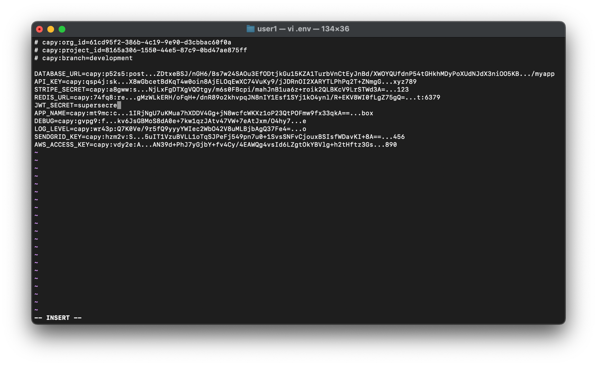
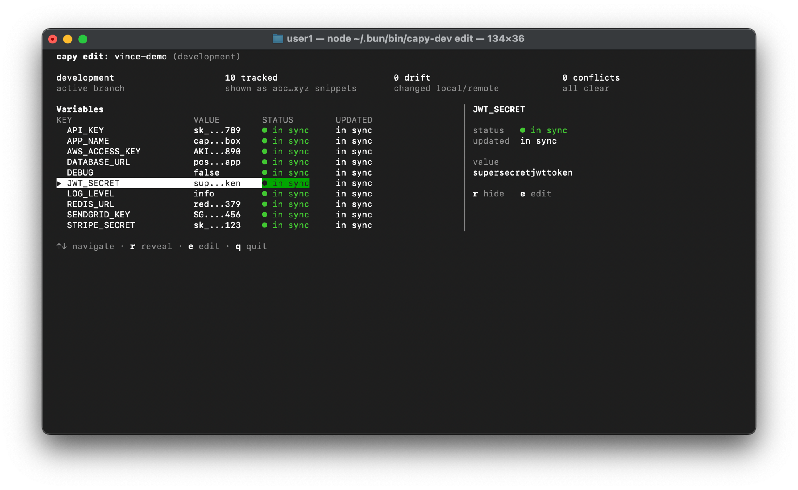

<br />
<br />

<h1 align="center">
  <picture>
    <source media="(prefers-color-scheme: dark)" srcset="./docs/images/logo-dark.svg">
    <source media="(prefers-color-scheme: light)" srcset="./docs/images/logo-light.svg">
    
  </picture>
</h1>

<br />
<br />

<p align="center">
  <strong>Like git, built for secrets.</strong>
  <br /><br />
  <a href="#install">Install</a>
  ·
  <a href="#quickstart">Quickstart</a>
  ·
  <a href="https://docs.capy.sc">Documentation</a>
  ·
  <a href="https://github.com/capysc/capy-cli/releases">Changelog</a>
  ·
  <a href="https://github.com/capysc/capy-cli/issues">Issues</a>
</p>

<p align="center">
  <a href="https://github.com/capysc/capy-cli/actions/workflows/ci.yml"></a>
  <a href="https://github.com/capysc/capy-cli/actions/workflows/ci.yml"></a>
  <a href="https://www.npmjs.com/package/@capysc/cli"></a>
  <a href="https://nodejs.org"></a>
  <a href="./LICENSE"></a>
</p>

Capy is a secrets toolchain with git-style primitives — branch, sync, deploy, revoke — end-to-end encrypted on your machine and fully revocable for humans and agents. Your `.env` becomes versioned state your team can commit, roll back, and offboard without rotating a single key.

→ [Compare Capy to Doppler, Infisical, AWS Secrets Manager, and SOPS](https://docs.capy.sc/comparisons).

## Install

Capy in its most basic form is just a CLI: no lengthy signup, account setup, or SDK to import.

```bash
npm install -g @capysc/cli
```

Or with Bun:

```bash
bun add -g @capysc/cli
```

### Standalone installer (macOS and Linux) <!-- COPY-FLAG -->

No Node or npm needed. <!-- COPY-FLAG -->

```bash
curl -fsSL https://capy.sc/install.sh | sh
```

The installer downloads the binary for your system from GitHub Releases and checks its SHA-256 before installing. If Capy is already installed as a standalone file, it is replaced in place. If Capy came from Homebrew or npm, the installer stops and nothing is changed: update with `brew upgrade capy` or `npm install -g @capysc/cli`. <!-- COPY-FLAG -->
For a new install it uses `/usr/local/bin` when that folder is on your `PATH` and writable, otherwise `~/.local/bin`. `CAPY_INSTALL_DIR` sets the folder. <!-- COPY-FLAG -->
`CAPY_PREFIX` is the older name and still works: the binary goes to `$CAPY_PREFIX/bin`. If both are set, `CAPY_INSTALL_DIR` wins. <!-- COPY-FLAG -->
`CAPY_NO_NPM_FALLBACK` is accepted and ignored, because there is no npm fallback. `CAPY_FORCE_NPM=1` stops and prints the npm command. <!-- COPY-FLAG -->

### Windows PowerShell

Use the native PowerShell installer, not `install.sh`:

```powershell
irm https://capy.sc/install.ps1 | iex
capy --version
```

Or download and run it using Windows' `curl.exe`:

```powershell
$installer = curl.exe -fsSL https://capy.sc/install.ps1 | Out-String
if ($LASTEXITCODE -ne 0) { throw 'Installer download failed' }
Invoke-Expression $installer
capy --version
```

`capy --version` includes a UTC build number and, for builds from a Git checkout, the first eight characters of the source commit.

### Install a specific version <!-- COPY-FLAG -->

Each release publishes its own `install.sh` and `install.ps1` with that version's checksums. To pin a version, run the installer with `CAPY_VERSION`: <!-- COPY-FLAG -->

```bash
curl -fsSL https://raw.githubusercontent.com/capysc/capy-cli/main/install.sh | CAPY_VERSION=<version> sh
```

Or use the versioned release URL directly: <!-- COPY-FLAG -->

```bash
curl -fsSL https://github.com/capysc/capy-cli/releases/download/v<version>/install.sh | sh
```

### Remove the standalone binary <!-- COPY-FLAG -->

Delete the `capy` file from the folder the installer printed. The `~/.capy` folder holds your keys: do not delete it to reinstall. <!-- COPY-FLAG -->

## Quickstart

```bash
capy                              # sync secrets
capy edit                         # inspect & edit secrets in a TUI
capy invite rachael@tyrell.com    # add a teammate
capy kick roy@tyrell.com          # remove a teammate
capy run -- npm run dev           # run with decrypted secrets
capy deploy                       # ship to prod
```

On first setup, choose the folder containing your app. From an agent, use its project folder or pass `capy --folder <path>`.

- **Set up this folder only** *(default)*. When teammates set up their own copy of the app, they’ll need to choose this project in Capy to get its secrets.
- **Share the setup through Git**. Capy commits `keep.lock` so copies of the same code point to the same Capy project and secret versions (this is useful for keeping larger teams or more complex projects in sync).

## Demo


https://github.com/user-attachments/assets/60800e68-6101-4f1a-9176-6b2d58a6fd61


## Why Use Capy

- **We hold ciphertext. You hold keys. A subpoena gets us nothing.** Our service stores membership records and ciphertext. We don't hold your master key, your project keys, or any plaintext. Compromise of our service OR your local values yields nothing useful.
- **Revocation is cryptographic, not a database flag.** `capy kick` makes the kicked user's local `key.enc` cryptographically inert. Remaining users keep using the same keys; no rotation cascade.
- **Your code stays vanilla `process.env`.** No SDK to import, no daemon to run, no dashboard to maintain. `capy run` injects decrypted values into Node, Python, Go, Ruby, or any process that reads env vars.
- **Optional Git sharing.** Each folder remembers its Capy project and secret versions. Teams can share those pointers with the code by tracking `keep.lock` in Git.
- **Source-available CLI.** AGPL-3.0. Code is auditable on GitHub. ([What AGPL means for your team in practice.](https://docs.capy.sc/using/license))

## How it works

Capy is a zero-trust secrets manager: we start by encrypting your `.env` on your machine. The encrypted secrets then sync to our service, and your team decrypts them on their own machines. We never see plaintext at any point.

<p align="center">
  <picture>
    <source media="(prefers-color-scheme: dark)" srcset="./docs/images/01-trust-dark.svg">
    <source media="(prefers-color-scheme: light)" srcset="./docs/images/01-trust.svg">
    
  </picture>
</p>

Decryption is a two-party operation: our service strips the outer wrap of your `key.enc`, your machine strips the inner. Neither side has both keys.

For the full threat model, see [docs.capy.sc/internals/zero-trust](https://docs.capy.sc/internals/zero-trust). For the cryptographic constructions, see [docs.capy.sc/internals/cryptography](https://docs.capy.sc/internals/cryptography).

## Encrypt at source

Most secrets managers encrypt at rest on their servers. Capy is one of the few that encrypts at source. Every value in your `.env` is ciphertext on your machine before any of it crosses the wire, making Capy a uniquely zero-trust, end-to-end secrets control system built for humans and agents alike.

<p align="center">
  
</p>

Each value is a `capy:{resourceId}:{ciphertext}` snippet only your team can decrypt, but with just enough characters surrounding the ciphertext for you to identify the items. Plaintext only exists in process memory while `capy run` has your app spawned.

## Editing secrets

Two ways to change a value. Both end up encrypted and synced — pick whichever fits the moment.

### Edit `.env` in place

Open `.env` in your editor and overwrite a `capy:...` snippet with the new plaintext value. The next `capy` sync re-encrypts whatever changed and updates `keep.lock`.

<p align="center">
  
</p>

Good when you're already in your editor, pasting a new key from a dashboard, or scripting a bulk change.

### Edit through the TUI (`capy edit`)

`capy edit` opens an interactive table of every variable on the current branch with sync status, drift, and conflicts visible at a glance. Reveal a value with `r`, edit with `e`, navigate with `↑↓`, quit with `q`.

<p align="center">
  
</p>

Good when you want to see drift across the whole branch, edit one variable without touching the file, or check what's in sync before a deploy.

## Commands

| Command | Description |
|---------|-------------|
| [`capy`](https://docs.capy.sc/cli/capy) | Sync secrets. Initializes on first run. |
| [`capy run -- <cmd>`](https://docs.capy.sc/cli/run) | Run a command with decrypted secrets injected. |
| [`capy edit`](https://docs.capy.sc/cli/edit) | Inspect and edit secrets in an interactive TUI. |
| [`capy status`](https://docs.capy.sc/cli/status) | Show drift between local, pinned, and remote. |
| [`capy push`](https://docs.capy.sc/cli/push) | Push local changes. Runs the same sync as `capy`, so any difference is settled first. |
| [`capy lock`](https://docs.capy.sc/cli/lock) | Lock the local key so the passphrase is required next time. |
| [`capy deploy`](https://docs.capy.sc/cli/deploy) | Generate a deploy token and walk through platform setup. |
| [`capy connect <provider>`](https://docs.capy.sc/cli/connect) | Pull a credential from a provider into `.env`. |
| [`capy rotate [var]`](https://docs.capy.sc/cli/rotate) | Rotate a managed credential. |
| [`capy invite <email>`](https://docs.capy.sc/cli/invite) | Invite a teammate. |
| [`capy redeem <code>`](https://docs.capy.sc/cli/redeem) | Redeem an invite code. |
| [`capy transport`](https://docs.capy.sc/cli/transport) | Move your account to another machine. |
| [`capy kick <email>`](https://docs.capy.sc/cli/kick) | Remove a teammate. |
| [`capy users`](https://docs.capy.sc/cli/users) | Interactive user management. |
| [`capy projects`](https://docs.capy.sc/cli/projects) | List projects in the org and their branches. |
| [`capy project create\|delete\|restore`](https://docs.capy.sc/cli/project) | Create, delete or restore a project in the org. |
| [`capy secrets`](https://docs.capy.sc/cli/secrets) | List every secret name in the org, grouped by value (never shows a value). |
| [`capy org`](https://docs.capy.sc/cli/org) | List or switch organizations. |
| [`capy branch`](https://docs.capy.sc/cli/branch) | List or switch branches. |
| [`capy checkout <branch>`](https://docs.capy.sc/cli/checkout) | Switch branches. `-b` to create. |
| [`capy grant-branch`](https://docs.capy.sc/cli/grant-branch) | Grant access to a protected branch. |
| [`capy revoke-branch`](https://docs.capy.sc/cli/revoke-branch) | Revoke branch access. |
| [`capy recover`](https://docs.capy.sc/cli/recover) | Restore access from your recovery phrase. |
| [`capy end-recover`](https://docs.capy.sc/cli/end-recover) | End a recovery session. |
| [`capy decrypt`](https://docs.capy.sc/cli/decrypt) | Decrypt secrets offline (owner only). |
| [`capy use <profile>`](https://docs.capy.sc/cli/use) | Switch between configured profiles. |
| [`capy profile`](https://docs.capy.sc/cli/profile) | Manage CLI profiles. |
| [`capy byoc [url]`](https://docs.capy.sc/cli/byoc) | Connect to a self-hosted Capy instance. |
| [`capy info`](https://docs.capy.sc/cli/info) | Show current session info. |
| [`capy agents`](https://docs.capy.sc/cli/agents) | Tell AI coding agents in this repo how to use Capy (writes AGENTS.md / CLAUDE.md). |
| [`capy logout`](https://docs.capy.sc/cli/logout) | Clear local session. |
| [`capy cleanup`](https://docs.capy.sc/cli/cleanup) | Remove git hooks and local state. |

### Pairing from an agent

Run `capy pair --json` without asking the human anything first. On a machine
with no keys yet it first asks, as a form, whether to pick up the organization's
keys (`--transport`) or create a new organization (`--signup`): ask the human,
never choose yourself. Then it asks for the pairing, saves it, and exits
**3** at once with `PAIR_APPROVAL_PENDING` and an elicitation of kind `link`
(`url`, `code`, `purpose`, `expires_at`, `answer.wait`, and a `qr`).

Always show the human the link, the code and the expiry. Show the QR in this
order:

1. If your client can show images, show the PNG: attach or send `qr.image.file`
   (a temporary 0600 file), or decode `qr.image.data_uri`.
2. Show `qr.text` only if your client is a real terminal with a monospace grid
   and no extra line spacing.
3. Otherwise say plainly that the QR cannot be shown here.

Never use an external QR service. If the CLI runs inside another runtime, copy
the PNG to the display environment or decode its data URI there.

Then run `answer.wait` (`capy pair --wait`) at once in the foreground, and run it
again whenever it exits 3 with `PAIR_STILL_WAITING`. That answer repeats the link
and only the PNG's file path, not `qr.text` or `qr.image.data_uri`. After the
human approves, Keep shows them a one-time code, and the wait exits 3 with
`PAIR_CODE_REQUIRED` and a form with one `code` field. Ask the human for the code
and run `capy pair --wait --code <code>`; a wrong code returns
`PAIR_CODE_MISMATCH` with the form again, and five wrong codes cancel the
pairing (`PAIR_CODE_FAILED`). Never fill in the code yourself: only the person
who approved can see it, which is what stops someone else's approval from
installing anything. No email is ever asked: the code is the check.
When the keys are already on this machine, the pairing only signs in: the result says `"keys": "already_present"`.
The PNG is removed when the pairing ends (approval, expiry, denial,
`capy pair --cancel`, or a new `capy pair`). stdout is only ever one JSON
object. `capy help --json` publishes the same instructions (`conventions.pairing`).

## Syncing

`capy` compares the values in your folder with the latest on the service. A Git-shared setup also compares the versions pinned in `keep.lock`. Conflicts open an interactive resolver. See [docs.capy.sc/using/syncing-secrets](https://docs.capy.sc/using/syncing-secrets).

### Conflicts and agents

No command overwrites a value someone else changed since you last saw it. Every command that writes from a folder (`capy edit`, `add`, `remove`, `connect`, `rotate`, `push`, `deploy`, `org`, and `checkout` of an existing branch) runs a plain `capy` first. It repeats until your folder and Capy agree on every variable. If you cancel, nothing is written. Only then does the command apply its own change on top of Capy's latest. Unresolved conflicts block the write, including conflicts on other variables. Exceptions: `capy checkout -b`, `capy decrypt` (and checkout while recovering from a seed phrase), new projects, and the org system store.

In a folder-only setup, sync uses the last synced versions in `keep.lock`. It pulls changes made only in Capy and saves changes made only in this folder. If both sides changed the same variable differently, or an existing environment file has never synced and the versions differ, choose `local` to keep your folder’s version or `remote` to use Capy’s version. If one side has removed the variable, choosing that side removes it. In a Git-shared setup the choices are `pinned` (the folder's `keep.lock`), `local` (your `.env`), `remote` (Capy's latest), or `delete`.

Off a terminal (`--non-tty`, `--json`, an agent, CI) nobody can be asked. The command writes nothing, exits **3**, and prints JSON on stdout with `"code": "SECRETS_CONFLICT"`, a `conflict_id`, and one row per difference (name, project, branch, and fingerprints of the available sources). Ask the person, then rerun the same command once with `--resolve NAME=pinned|local|remote|delete` using the choices available for each row and `--conflict <conflict_id>`. A Dokploy platform value is answered as `NAME@TARGET=local|remote`. If anything moved in between, the command exits 3 again with `SECRETS_CONFLICT_STALE` and the fresh rows. Git-shared conflicts use `delete` for an explicit removal.

```bash
capy push --non-tty                                        # exit 3: SECRETS_CONFLICT, conflict_id c_...
capy push --non-tty --resolve API_KEY=local --conflict c_9f2e41a07b3d
```

The `capy secrets` edit screens and `capy secrets set` do the same check against the value you were shown. Uploads also carry the version they started from, and the server refuses a stale one. The CLI syncs again and retries once.

## Running your app

`capy run -- <cmd>` decrypts `.env` in memory and spawns your command with the values set as environment variables. Works in any runtime that reads env vars. See [docs.capy.sc/using/running-your-app](https://docs.capy.sc/using/running-your-app).

**Docker Compose:** `capy run -- docker compose up` works with an unchanged `env_file: .env`. Capy passes compose an extra override listing only the decrypted variable *names* for the services that read `.env`, so compose forwards the real values into those containers. Nothing is written to disk.

## Deploying

`capy deploy` walks through Vercel, Cloudflare, Docker, Fly, Railway, Render, Heroku, GitHub Actions, and AWS Lambda. See [docs.capy.sc/using/deploying](https://docs.capy.sc/using/deploying).

`capy deploy` runs a plain `capy` first, so it only ships values your folder and Capy agree on. For Dokploy, if a service's live value was changed outside Capy since the last delivery, you choose `local` (deliver Capy's value) or `remote` (keep the platform's value and skip it). Batch deploy from `capy secrets` delivers only the variables you picked.

## Team

`capy invite <email>` to add a teammate; `capy kick <email>` to remove one. Invite codes travel out-of-band; kicks are O(1) with no key rotation. See [docs.capy.sc/using/team/inviting](https://docs.capy.sc/using/team/inviting).

## Branches

Capy tracks versions on the service in both setup modes. A folder-only setup keeps its `keep.lock` locally and ignores it in Git.

A **Capy branch** is to your secrets what a git branch is to your code: a parallel state with its own values and its own access list. Switching branches changes which values `capy run` injects. As an example setup, you might keep a `development` branch open to every user while gating a `production` branch to only admins.

With **Share the setup through Git**, the committed `keep.lock` pins the project and secret versions for that copy of the code. Branch names are yours to choose, just like in git: a common pattern is sharing one shared dev branch across feature work and pinning `release-*` git branches to a separate staging or production branch.

For the full state model and protected-branch role enforcement, see [docs.capy.sc/using/branches/overview](https://docs.capy.sc/using/branches/overview).

## FAQ

<details>
<summary><strong>What is zero trust?</strong></summary>

Zero-trust is a cryptographic property: an attacker who fully compromises our service still can't decrypt your secrets, because every decryption requires a key share that lives only on your machine. Capy isn't asking you to trust us; the architecture ensures that compromising our service alone yields only ciphertext.
</details>

<details>
<summary><strong>What if I lose my seed phrase?</strong></summary>

If you're the org owner and you lose the seed phrase with no other device holding `key.enc`, you lose access to that org. Capy can't help; it's zero-trust by design, so recovery would require us to hold something we intentionally don't. Back the seed phrase up when it's shown (password manager, physical note in a safe).
</details>

<details>
<summary><strong>How do I migrate from plain dotenv?</strong></summary>

Run `capy` in a project that already has a `.env`. On first run, Capy treats your `.env` as authoritative, encrypts every value, uploads the ciphertext, and rewrites `.env` in place with `capy:...` snippets. A backup of your original `.env` is written to `.env.pre-capy.old` (gitignored).
</details>

<details>
<summary><strong>Does it work offline?</strong></summary>

The first sync needs network for authentication and key co-decrypt, but after that, `capy run` works offline against the local cache at `~/.capy/`. You can develop on a plane; you just can't pick up changes other teammates pushed.
</details>

<details>
<summary><strong>How fast does `capy kick` propagate?</strong></summary>

Immediately. On the kicked user's next request, the service refuses to strip the outer wrap; their `key.enc` becomes cryptographically inert on disk. The master key never rotates because remaining users can keep using it.
</details>

<details>
<summary><strong>Does this meet SOC 2 / GDPR requirements?</strong></summary>

SOC 2 audit is in progress. GDPR-compliant. Trust posture and ongoing reports at [trust.capy.sc](https://trust.capy.sc).
</details>

<details>
<summary><strong>What does Capy cost?</strong></summary>

Free for individuals and small teams. Paid plans for orgs that need higher quotas, more projects, or more users.
</details>

<details>
<summary><strong>Does it support SSO?</strong></summary>

Yes. Configure your identity provider (Okta, Azure AD, Google Workspace, etc.) when creating your organization and your team authenticates via the same provider as the rest of your stack.
</details>

<details>
<summary><strong>Can I self-host?</strong></summary>

Not currently. The service component is closed. If self-hosting matters for your compliance posture, get in touch.
</details>

<details>
<summary><strong>What if capy.sc goes down?</strong></summary>

`capy run` keeps working from the local cache, so your running apps don't break. New syncs pause until the service comes back.
</details>

<details>
<summary><strong>Does it work in CI?</strong></summary>

Yes. `capy deploy` generates `SECRETS_BLOB` and `PROJECT_KEY` to set as CI env vars; `capy run` in your build/test step does the rest. `capy deploy --yes` in CI exits 3 instead of proceeding if the folder and Capy differ on any variable; see [Conflicts and agents](#conflicts-and-agents). See the GitHub Actions guide at [docs.capy.sc/using/deploying/github-actions](https://docs.capy.sc/using/deploying/github-actions).
</details>

## Supply chain

Capy ships with five runtime dependencies. Each is a load-bearing piece of the CLI; nothing is included for convenience or to save a few lines of code. A small dependency footprint keeps the supply-chain attack surface tight.

| Dependency | Purpose | Status |
|------------|---------|--------|
| [`commander`](https://github.com/tj/commander.js) | CLI argument parsing | ✓ no known vulnerabilities |
| [`dotenv`](https://github.com/motdotla/dotenv) | `.env` file parsing | ✓ no known vulnerabilities |
| [`inquirer`](https://github.com/SBoudrias/Inquirer.js) | Interactive prompts | ✓ no known vulnerabilities |
| [`open`](https://github.com/sindresorhus/open) | OAuth browser launch | ✓ no known vulnerabilities |
| [`proper-lockfile`](https://github.com/moxystudio/node-proper-lockfile) | Atomic file locking | ✓ no known vulnerabilities |

Live audit status and the full transitive dep tree: [github.com/capysc/capy-cli/network/dependencies](https://github.com/capysc/capy-cli/network/dependencies).

[Dependabot](https://docs.github.com/en/code-security/dependabot) keeps dependencies current — see [`.github/dependabot.yml`](./.github/dependabot.yml). It opens weekly PRs for `npm` and `github-actions`, with dev dependencies grouped into a single PR per ecosystem.

## Security

Don't file public GitHub issues or discussions for security vulnerabilities. Those channels are public.

Capy takes security issues seriously. If you've found a vulnerability, email [security@capy.sc](mailto:security@capy.sc) with a description and ideally a way to reproduce it. We'll respond as soon as possible.

This address is for undisclosed vulnerabilities only. Please report security problems to us before disclosing them publicly.

## Contributing

You can fork this repo and create pull requests:

[github.com/capysc/capy-cli](https://github.com/capysc/capy-cli) - [bugs](https://github.com/capysc/capy-cli/issues) and [discussions](https://github.com/capysc/capy-cli/discussions)

### Publishing from a remote agent

Publish npm releases only from a verified commit on `origin/main`, after the
release PR has been merged and full CI for that exact commit has passed. Build
and pack from that commit; a detached worktree keeps `main` unchanged. Confirm
the product changes against the previous release before tagging or publishing.
Never publish a tarball built from a feature or release branch.

Maintainers can approve npm authentication on another device without a callback
to the publishing machine. Use npm 11.9 or newer with a supported Node version:

```sh
npm run release:login
npm run release:publish -- /absolute/path/to/reviewed-package.tgz
```

The login command prints npm's browser link and waits for npm's registry to
confirm approval. Publishing accepts a previously built and reviewed `npm pack`
artifact. If npm asks for another security-key approval, the helper prints its
link, polls the registry, and retries that same artifact once. It does not launch
a local browser or require an inbound callback. Complete approval within five
minutes; expired approvals require a fresh command.

Add `--json` to either command for newline-delimited status and approval events.
Only the browser approval link is emitted; registry polling URLs and one-time
tokens stay within the publishing process. Login credentials are saved by npm
in its normal user configuration.

## License

AGPL-3.0-only. Copyright © Incentv Technologies Inc.

See [LICENSE](./LICENSE) for the full text. For what AGPL means for your team in practice — when it imposes obligations and when it doesn't — see [docs.capy.sc/using/license](https://docs.capy.sc/using/license).

The prebuilt binaries embed their dependencies; those packages' licenses and copyright notices are reproduced in [THIRD-PARTY-NOTICES.md](./THIRD-PARTY-NOTICES.md).
